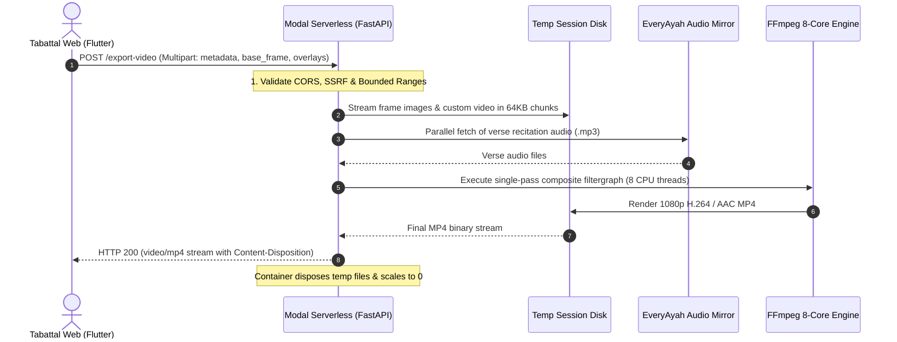

# 🎬 Tabattal Cloud Video Exporter

[](https://www.python.org/)
[](https://modal.com)
[](https://ffmpeg.org/)
[](#specifications)
[](#financial-governance--safety)

High-performance, serverless Quran video rendering microservice built for [Tabattal](https://tabattal.omar-afifi.com). Compiles 1080x1920 Full HD recitation videos with synchronized typography, smooth verse crossfades, and Apple AVFoundation-compliant AAC audio in **10 to 15 seconds**.

---

## 🌟 Key Features

- ⚡ **Ultra-Fast Video Compilation (10–15 Seconds):** Powered by dedicated **8 vCPUs and 16 GB RAM** container instances executing single-pass FFmpeg filtergraphs.
- 💰 **Zero Recurring Infrastructure Cost ($0.00):** Leverages Modal's **$30/month recurring compute credit**, capable of exporting **3,000 to 6,000+ Full HD videos every month** without exceeding the free allocation.
- 🛡️ **Hardened Enterprise Security:**
  - **SSRF Protection:** Validates target URLs against DNS rebinding, internal subnets, loopback, and cloud metadata services (`169.254.169.254`).
  - **Path Traversal Guards:** Enforces strict regex validation on recitation paths and prevents arbitrary file inclusion.
  - **Origin Isolation:** Restricts cross-origin invocation strictly to Tabattal's verified domain tree and authorized local testing origins.
  - **Memory Bounding:** Streams large multipart uploads (up to 250MB+ custom backgrounds) in 64KB disk chunks to maintain a minimal container memory footprint.
- 🎵 **Precision Audio-Visual Synchronization:** Automatically fetches verse recitations from primary and mirror EveryAyah endpoints, normalizes word timing offsets, and concatenates audio segments seamlessly.
- 📱 **Apple AVFoundation Compliance:** Employs standardized MP4 parameters (`yuv420p`, BT.709 colorimetry, 44.1 kHz AAC audio, and `+faststart` atom placement) for zero-stutter playback on iOS Safari, macOS QuickTime, and mobile web browsers.

---

## 🏗️ Architecture



---

## ⚙️ Specifications

| Parameter | Specification |
|---|---|
| **Platform** | [Modal.com](https://modal.com) Serverless Compute |
| **Framework** | FastAPI + Python 3.11 |
| **Compute Allocation** | **8.0 vCPUs** (Dedicated CPU threads) |
| **Memory Allocation** | **16,384 MB (16 GB RAM)** |
| **Encoding Preset** | `libx264` (`ultrafast`, CRF 18–26, 30 FPS) |
| **Audio Pipeline** | Native AAC stereo, 192 kbps, 44,100 Hz |
| **Color Matrix** | BT.709 (`colorprim=bt709:transfer=bt709:colormatrix=bt709:range=tv`) |
| **Max Payload Size** | Up to 250 MB (Supports high-resolution custom video backgrounds) |
| **Container Lifecycle** | Scale-to-zero when idle (~1s warm spin-up) |

---

## 🚀 1-Click Deployment Guide

### Prerequisites
1. [Python 3.10+](https://www.python.org/downloads/) installed and accessible in `PATH`.
2. A free account registered on [Modal.com](https://modal.com).

### Automated Deployment (Windows PowerShell)
Navigate to the `server/` directory and run the deployment script:

```powershell
cd server
.\deploy.ps1
```

The script will automatically:
1. Verify Python and install required dependencies (`modal`, `fastapi`, `aiohttp`, `pillow`, `requests`).
2. Open your default browser to authenticate your Modal session (first-time setup only).
3. Package and deploy `main.py` onto Modal's global edge infrastructure.
4. Output your live production URL:
   ```text
   https://YOUR_USERNAME--tabattal-video-exporter-export-video.modal.run
   ```

---

## 🧪 Verification & Testing

Verify that your deployed serverless endpoint is fully operational by executing the automated test client:

```bash
python test_client.py https://YOUR_USERNAME--tabattal-video-exporter-export-video.modal.run
```

Expected output:
```text
==========================================================
  Tabattal Cloud Video Exporter - End-to-End Test Client  
==========================================================
[*] Target Endpoint: https://...modal.run
[*] Generating synthetic test assets (1080x1920)...
[*] Transmitting multipart payload to serverless container...

[+] TEST PASSED!
[+] Total execution time: 12.41 seconds
[+] Downloaded MP4 size:  7.84 MB
[+] Saved output file to: test_tabattal_render.mp4
```

---

## 🔒 Financial Governance & Safety

Modal provides an explicit hard budget lock to eliminate surprise cloud billing:

1. Navigate to **[Modal Settings → Billing](https://modal.com/settings/billing)**.
2. Locate the **Spending Limit** setting.
3. Configure the threshold to **`$0.00`** above the free tier.
4. **Guaranteed Outcome:** If monthly usage ever reaches the free $30.00 allocation, the endpoint halts automatically. No credit card charges can ever occur.

---

## 📡 API Specification

### `POST /export-video`

Accepts `multipart/form-data` containing the video composition payload.

#### Headers
| Header | Value | Description |
|---|---|---|
| `Origin` | `https://tabattal.omar-afifi.com` | Verified caller domain |
| `Content-Type` | `multipart/form-data; boundary=...` | Form multipart boundary |

#### Form Fields
| Field Name | Type | Description |
|---|---|---|
| `metadata` | `string` (JSON) | Composition parameters (surah, ayah range, reciter path, units, target dimensions) |
| `base_frame` | `file` (JPEG/PNG) | Base background canvas graphic |
| `overlay_unit_N` | `file` (PNG) | Rendered transparent overlay frames for each verse line |
| `custom_video` | `file` (MP4) | *(Optional)* Custom background video file (up to 250MB) |

#### Response
- **Status `200 OK`**: Binary MP4 stream (`Content-Type: video/mp4`) with `Content-Disposition: attachment; filename="Tabattal_Surah_...mp4"`.
- **Status `400 / 403 / 500`**: Standardized JSON error response:
  ```json
  {
    "code": "INVALID_RANGE",
    "message": "Invalid verse range (maximum 10 verses per export).",
    "messageEn": "Invalid verse range (maximum 10 verses per export).",
    "messageAr": "نطاق الآيات غير صالح (بحد أقصى 10 آيات)."
  }
  ```

---

## 🔗 Integration with Tabattal Flutter Web

To connect Tabattal's web client to this service, configure the environment variable in your root `.env` file:

```env
VIDEO_EXPORT_API_URL=https://YOUR_USERNAME--tabattal-video-exporter-export-video.modal.run
```

When building Tabattal for production:
```powershell
.\build_and_export.ps1 -BuildWeb
```

The build script will inject this URL into Flutter's compile-time environment (`--dart-define=VIDEO_EXPORT_API_URL=...`), ensuring seamless client-side integration.

---

## 📄 License

This microservice is an integral part of the open-source **Tabattal** project, licensed under the [GNU General Public License v3.0](../../LICENSE).
